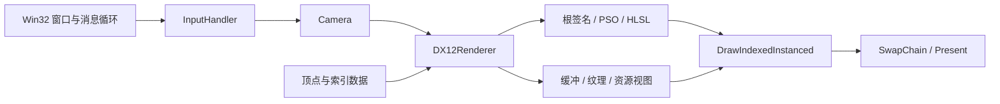

# DX12Renderer

**基于 DirectX 12 的三维渲染与 GPU 资源管理个人作品。**

`C++17` · `DirectX 12` · `HLSL` · `DirectXMath` · `Win32`

项目使用原生图形 API 实现交互式三维渲染 Demo，覆盖窗口与输入、渲染管线、几何绘制、深度测试、矩阵变换及纹理上传。实现重点是 CPU/GPU 数据布局的一致性、资源状态与生命周期的显式管理，以及按依赖划分的初始化流程。

## 项目展示

当前场景包含两个随时间绕 Y 轴旋转的立方体，支持自由移动和转动相机。两个立方体分别使用标准 UV 与翻转 V 的 UV，通过像素颜色观察坐标传递和插值结果；深度缓冲处理几何体之间的遮挡。

| 交互 | 效果 |
| --- | --- |
| W / S | 沿相机朝向前进 / 后退 |
| A / D | 横向移动 |
| 按住鼠标右键并移动 | 调整相机的俯仰与偏航 |
| 关闭窗口 | 退出程序 |

当前像素输出为 `float4(U, V, 1, 1)`，红色与绿色分别表示 U、V。**已实现纹理资源上传及绑定准备，当前画面使用 UV 调试颜色；图片加载和实际纹理采样尚未启用。**

## 实现亮点

| 能力 | 具体实现 |
| --- | --- |
| DirectX 12 绘制链路 | 创建硬件设备、命令队列、双缓冲交换链、根签名和 PSO，通过索引绘制生成三维场景并提交显示 |
| 深度测试与变换 | 使用 `D32_FLOAT` 深度缓冲和 `LESS` 比较；每帧计算并上传 MVP，完成模型、视图和投影变换 |
| 相机与输入 | 通过 `InputHandler` 接口接收 Win32 键鼠事件，使用 DirectXMath 更新相机朝向、位置和视图矩阵 |
| CPU/GPU 数据契约 | 用 `XMFLOAT3 / XMFLOAT4 / XMFLOAT2` 保存顶点，通过 `offsetof` 和 `sizeof` 将字段、输入格式与 HLSL 语义对应 |
| 纹理上传与资源同步 | 用 `GetCopyableFootprints` 获取复制布局，按行跨度写入 UPLOAD 缓冲，记录纹理复制及状态转换，并用 fence 保证上传资源的生命周期 |
| 初始化组织与复用 | 将初始化划分为 10 个阶段，统一缓冲创建与写入；使设备、窗口目标、管线、场景数据和纹理准备的职责清晰 |
| 错误诊断与资源管理 | 检查关键调用的 `HRESULT`，输出操作名称和系统错误信息；使用 `ComPtr` 管理 COM 资源 |

## 核心设计

### 模块关系



初始化按“设备与命令 → 窗口及深度目标 → 相机与视口 → 管线 → 几何和常量缓冲 → 纹理”执行。采样器与根签名一起创建，输入布局与 PSO 一起创建，描述结构保留在对应阶段的局部作用域。

| 代码入口 | 职责 |
| --- | --- |
| [main.cpp](main.cpp) | 窗口创建、消息循环和输入事件分发 |
| [DX12Renderer.cpp](DX12Renderer.cpp) / [DX12Renderer.h](DX12Renderer.h) | 初始化阶段、GPU 资源、绘制提交与 fence 同步 |
| [camera.cpp](camera.cpp) / [camera.h](camera.h) | 相机移动、鼠标视角及视图/投影矩阵 |
| [base.h](base.h) | 顶点与变换常量的数据结构 |
| [shader.hlsl](shader.hlsl) | 顶点变换、UV 传递和像素输出 |

### 顶点布局与常量传递

| 顶点字段 | CPU 类型 | HLSL 类型 / 语义 | 字节偏移 |
| --- | --- | --- | --- |
| `position` | `XMFLOAT3` | `float3 / POSITION` | 0 |
| `color` | `XMFLOAT4` | `float4 / COLOR` | 12 |
| `uv` | `XMFLOAT2` | `float2 / TEXCOORD0` | 28 |

顶点步长为 36 字节。输入布局使用 `offsetof(Vertex, ...)`，顶点缓冲视图使用 `sizeof(Vertex)`，让数据结构和输入描述保持一致。

CPU 每帧计算 `MVP = model * view * projection`，写入持续映射、按 256 字节对齐分配的常量缓冲。顶点着色器通过 `b0` 读取 `row_major float4x4 MVP`，并执行 `mul(float4(position, 1), MVP)`。

### 上传资源的生命周期

纹理参数和像素数据集中在 `prepareTextureData()`；创建、录制复制与提交等待由独立函数负责。

```text
CPU 像素数据 → UPLOAD 缓冲 → CopyTextureRegion → DEFAULT 堆纹理
                                              ↓
                            COPY_DEST → PIXEL_SHADER_RESOURCE
```

上传缓冲由初始化函数持有，在命令列表提交并等待对应 fence 完成后才释放。纹理资源与 SRV 保留供后续绘制使用，避免 GPU 尚未读取源数据时上传缓冲就被销毁。

## 构建与运行

### 环境要求

- Windows 10 / Windows 11。
- Visual Studio 2022，安装“使用 C++ 的桌面开发”、MSVC v143 和 Windows 10/11 SDK。
- 支持 DirectX 12 Feature Level 12_0 的硬件适配器。

项目使用 Windows SDK 提供的 DirectX 12、DXGI、D3DCompiler 和 DirectXMath，无需额外的第三方图形框架。

### 快速启动

1. 打开仓库根目录的 `DX12_Start.sln`。
2. 选择 `Debug | x64`，将 `DX12_Start` 设为启动项目。
3. 将“项目属性 → 调试 → 工作目录”设为 `$(ProjectDir)`。
4. 编译后按 F5 或 Ctrl+F5 运行。

也可以在 Visual Studio Developer PowerShell 中进入仓库根目录执行：

```powershell
msbuild .\DX12_Start.vcxproj /p:Configuration=Debug /p:Platform=x64
.\x64\Debug\DX12_Start.exe
```

HLSL 在程序启动时编译，运行时需要从工作目录找到 `shader.hlsl`，因此命令应在仓库根目录执行。

## 项目范围与后续方向

当前版本聚焦基础三维绘制、可交互相机和显式 GPU 资源管理。后续计划包括：

- **纹理显示：**当前仅上传单 mip、零填充的 RGBA8 数据；增加图片加载、实际采样和 mipmap 支持。
- **帧资源管理：**当前每帧提交后等待 GPU；增加独立帧资源，支持 CPU/GPU 多帧并行。
- **窗口与输入：**补充窗口尺寸变化时的资源重建，并按帧间隔计算相机移动。
- **几何与 UV：**为立方体各面建立独立顶点及 UV，扩展模型与材质数据。
