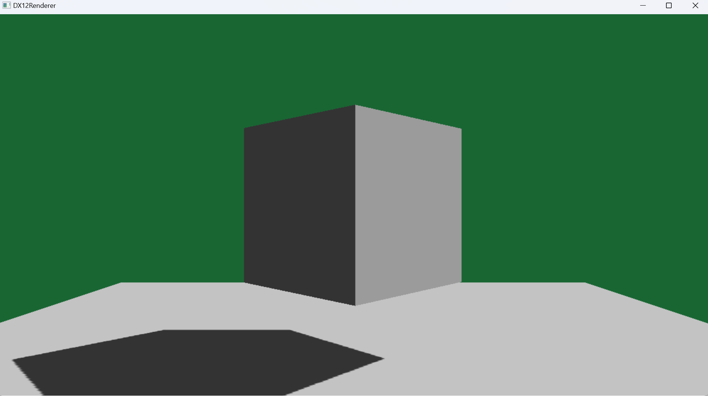

# DX12Renderer

A personal 3D rendering project built with **C++17, DirectX 12, HLSL, DirectXMath, and Win32**.

**Directional lighting and real-time Shadow Mapping are enabled.** The current demo renders a rotating cube casting a real-time directional shadow onto a static ground plane, with ambient and directional diffuse lighting and an interactive camera.

## Implemented Features

- Two-pass rendering pipeline: a `1024x1024` orthographic **Shadow Pass** (`ShadowVSMain`) followed by the perspective **Main Pass** (`VSMain` / `PSMain`).
- A rotating cube and a static ground plane rendered with indexed drawing, depth testing, per-face normals, and UV coordinates.
- Hardware 2x2 PCF shadow sampling via `SampleCmpLevelZero` at `t1` / `s1` (`LESS_EQUAL` comparison sampler with border color and depth bias).
- A camera supporting keyboard movement and mouse look.
- MVP, inverse-transpose normal matrix, and light-space `lightMVP` transforms with adjustable ambient and directional diffuse lighting.
- PNG/JPEG loading from files or encoded memory through an image loader adapted from SoftRenderer, using its bundled **stb_image v2.30**, with RGBA8 texture upload and SRV binding at `t0` / `s0`.

The default texture is `assets/textures/house_atlas.png`, copied from SoftRenderer's demo assets.

## Technical Highlights

- **Rendering pipeline:** Two-pass command recording (`renderShadowPass` -> barrier -> `renderMainPass`), shared root signature with `RootParameterSlot` enum, per-pass PSOs built from `createDefaultPSODesc()`, and a double-buffered swap chain.
- **Shadow map resources:** `DXGI_FORMAT_R32_TYPELESS` depth texture paired with a dedicated `D32_FLOAT` DSV heap for depth writes and an `R32_FLOAT` SRV slot in the shader-visible `CBV_SRV_UAV` heap for main-pass sampling.
- **Data layout:** DirectXMath vertex types matched to HLSL through `offsetof`; persistently mapped multi-object transform buffer (`b0`, 256-byte aligned slots per object) and lighting buffer (`b1`).
- **GPU resource management:** Explicit `ResourceBarrier` transitions (`PRESENT <-> RENDER_TARGET` and `DEPTH_WRITE <-> PIXEL_SHADER_RESOURCE`), fence synchronization, and `#ifdef _DEBUG` D3D12 Debug Layer diagnostics.
- **Code organization:** Renderer split by responsibility across `DX12Renderer.cpp` (passes and frame updates), `DX12Init.cpp` (device/swap chain/targets), `DX12Pipeline.cpp` (root signature/shaders/PSO defaults), `DX12Resources.cpp` (geometry/buffers/textures), and `DX12Utils.cpp` (upload/sync/error helpers), with `ComPtr` ownership and `HRESULT` error checks.

## Build and Run

Requires Windows 10/11, Visual Studio 2022 with **Desktop development with C++**, MSVC v143, a Windows SDK, and a GPU supporting DirectX 12 Feature Level 12_0.

1. Open [DX12Renderer.sln](DX12Renderer.sln).
2. Select **Debug | x64** and set **DX12Renderer** as the startup project.
3. Build and run with **F5** or **Ctrl+F5**.

Keep the debugger's working directory set to `$(ProjectDir)` (configured in the project). The application compiles `shader/shader.hlsl` and loads the default texture at startup. The build also copies both files to the output directory, allowing the executable to run from that directory.

## Controls

| Control | Action |
| --- | --- |
| W / S | Move forward / backward |
| A / D | Move sideways |
| Hold right mouse button and move | Look around |
| Close the window | Exit |

## Image Loading

To use another texture, place the image in `assets/textures/` and change the path in `DX12Renderer::prepareTextureData()` in [DX12Resources.cpp](Renderer/DX12Resources.cpp). Paths are relative to the working directory and use UTF-8. Update `CopyRuntimeAssets` in [DX12Renderer.vcxproj](DX12Renderer.vcxproj) as well to include the replacement image when running from the output directory.

[image.h](Application/image.h) provides `image::createImage(path)` and `image::createImageFromMemory(encodedData, byteCount, sourceName)`. The memory overload accepts encoded image bytes, such as the contents of a PNG file. Both return an image by value whose `mData` vector owns its pixels, so no `destroyImage()` call is needed.

Pixels use tightly packed **R, G, B, A** bytes with the first row at the **top**, matching the cube's UV layout. The texture uses the image's dimensions independently of the window size, and the upload code handles GPU row alignment. Missing or invalid images report the source name and decoding error.

The texture upload and `t0` SRV binding remain active; `PSMain` currently shades with vertex color, directional lighting, and the `t1` shadow map so shadow contrast stays clear.

To adjust light direction, color, and ambient/diffuse intensity, edit `UpdateLightBuffer()` in [DX12Renderer.cpp](Renderer/DX12Renderer.cpp).
