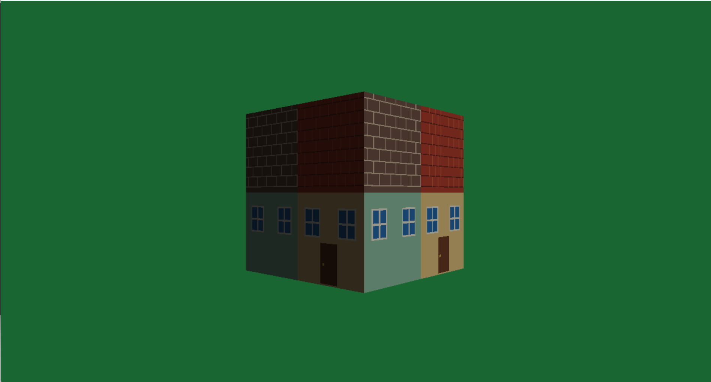

# DX12Renderer

A personal 3D rendering project built with **C++17, DirectX 12, HLSL, DirectXMath, and Win32**.

A rotating textured cube with per-face normals, ambient lighting, and directional diffuse shading.

## Implemented Features

- A rotating cube with indexed drawing, depth testing, and per-face normals.
- A camera supporting keyboard movement and mouse look.
- MVP transforms and world-space normals with adjustable ambient and directional diffuse lighting.
- A dedicated LightBuffer passed to the pixel shader through `b1`.
- RGBA8 texture creation, upload, SRV binding, and static sampler setup.
- PNG/JPEG image loading through the image system adapted from SoftRenderer and its bundled stb_image v2.30.
- Pixel shader texture sampling combined with vertex tint and ambient/directional diffuse lighting.

The default texture is `assets/textures/house_atlas.png`, copied from SoftRenderer's demo assets.

## Technical Highlights

- **Rendering pipeline:** Command queue/list, root signature, PSO, and a double-buffered swap chain.
- **Data layout:** DirectXMath vertex types matched to HLSL through `offsetof`; separate, persistently mapped transform (`b0`) and lighting (`b1`) buffers with 256-byte aligned allocations.
- **GPU resource management:** Explicit state transitions and fence synchronization, keeping upload buffers alive until the GPU finishes.
- **Code organization:** Initialization split into stages, shared buffer helpers, `ComPtr` ownership, and `HRESULT` error checks.

## Build and Controls

Requires Windows 10/11, Visual Studio 2022 with **Desktop development with C++**, MSVC v143, a Windows SDK, and a GPU supporting DirectX 12 Feature Level 12_0.

1. Open [DX12_Start.sln](DX12_Start.sln).
2. Select **Debug | x64** and set **DX12_Start** as the startup project.
3. Build and run with **F5** or **Ctrl+F5**.

Keep the debugging working directory set to `$(ProjectDir)` (configured by default). The application compiles `shader/shader.hlsl` at startup.
The build also copies the shader and default texture to the output directory so the executable can run with that directory as its working directory.

## Image Loading

Change the image path in `DX12Renderer::prepareTextureData()` to select a different texture. Paths are relative to the working directory and use UTF-8. If adding a new default asset, update `CopyRuntimeAssets` in the project file as well.

`Application/image.h` provides `image::createImage(path)` and `image::createImageFromMemory(encodedData, byteCount, sourceName)`. The memory overload accepts encoded image bytes, such as the contents of a PNG file; it does not accept an uncompressed pixel array. Both return an image by value whose `mData` vector owns its pixels, so no `destroyImage()` call is needed.

Pixels use tightly packed **R, G, B, A** bytes with the first row at the **top**. Unlike SoftRenderer's GDI framebuffer, no red/blue swap or vertical flip is applied. Image dimensions drive texture allocation, independently of the window size. The upload code handles the GPU's row alignment. Missing or invalid images throw an exception containing the source name and decoding error, instead of silently producing a black texture.

The pixel shader currently uses the image's RGB and preserves vertex alpha for opaque rendering. Image alpha is available in the loaded data but is not used for transparency.

To adjust light direction, color, and ambient/diffuse intensity, edit `UpdateLightBuffer()` in [DX12Renderer.cpp](Renderer/DX12Renderer.cpp).

| Control | Action |
| --- | --- |
| W / S | Move forward / backward |
| A / D | Move sideways |
| Hold right mouse button and move | Look around |
| Close the window | Exit |
