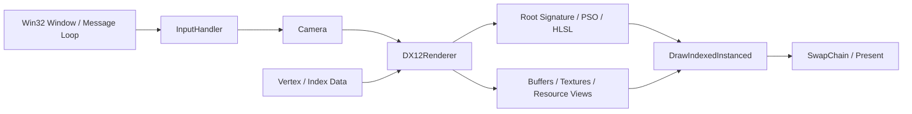

# DX12Renderer

**An interactive 3D renderer built with DirectX 12, with explicit GPU resource management.**

`C++17` · `DirectX 12` · `HLSL` · `DirectXMath` · `Win32`

This personal project implements a 3D rendering demo using the native graphics API, covering window creation and input, pipeline setup, indexed geometry, depth testing, matrix transforms, and texture uploads. The implementation focuses on consistent CPU/GPU data layouts, explicit resource states and lifetimes, and initialization stages organized by dependency.

## Demo

The scene contains two cubes rotating around the Y axis and a camera controlled with the keyboard and mouse. One cube uses standard UV coordinates; the other flips the V coordinate. The pixel shader visualizes UV interpolation as color, while the depth buffer handles occlusion.

| Control | Action |
| --- | --- |
| W / S | Move forward / backward |
| A / D | Move sideways |
| Hold the right mouse button and move | Adjust camera pitch and yaw |
| Close the window | Exit the application |

The current pixel output is `float4(U, V, 1, 1)`, with red and green representing U and V. Texture allocation, upload, and binding setup are implemented. The visible demo uses UV debug colors; image loading and texture sampling are not yet enabled.

## Implementation Highlights

| Area | Implementation |
| --- | --- |
| DirectX 12 rendering | Creates a hardware device, command queue, double-buffered swap chain, root signature, and PSO; submits indexed draws and presents the scene |
| Depth testing and transforms | Uses a `D32_FLOAT` depth buffer with `LESS` comparison; computes and uploads the model-view-projection matrix each frame |
| Camera and input | Routes Win32 keyboard and mouse events through `InputHandler`; uses DirectXMath to update camera position, orientation, and view matrices |
| CPU/GPU data layout | Stores vertex attributes in `XMFLOAT3 / XMFLOAT4 / XMFLOAT2`; uses `offsetof` and `sizeof` to match the input layout to the C++ structure and HLSL semantics |
| Texture uploads and synchronization | Uses `GetCopyableFootprints` for copy layouts, writes rows using the required pitch, records texture copies and state transitions, and retains upload resources until fence completion |
| Initialization structure | Separates setup into 10 stages and shares buffer creation and writing helpers across geometry, constants, and texture uploads |
| Diagnostics and resource ownership | Checks key `HRESULT` results with operation names and system error messages; manages COM resources with `ComPtr` |

## Design

### Module Overview



Initialization proceeds from device and commands to render targets and depth, camera and viewport, pipeline, geometry and constant buffers, and finally textures. The static sampler is created with the root signature, and the input layout is defined with the PSO. Setup descriptors stay local to their respective stages.

| Source | Responsibility |
| --- | --- |
| [main.cpp](main.cpp) | Window creation, message loop, and input dispatch |
| [DX12Renderer.cpp](DX12Renderer.cpp) / [DX12Renderer.h](DX12Renderer.h) | Initialization stages, GPU resources, draw submission, and fence synchronization |
| [camera.cpp](camera.cpp) / [camera.h](camera.h) | Camera movement, mouse look, and view/projection matrices |
| [base.h](base.h) | Vertex and transform constant structures |
| [shader.hlsl](shader.hlsl) | Vertex transforms, UV interpolation, and pixel output |

### Vertex Layout and Constant Data

| Vertex Field | CPU Type | HLSL Type / Semantic | Byte Offset |
| --- | --- | --- | --- |
| `position` | `XMFLOAT3` | `float3 / POSITION` | 0 |
| `color` | `XMFLOAT4` | `float4 / COLOR` | 12 |
| `uv` | `XMFLOAT2` | `float2 / TEXCOORD0` | 28 |

The vertex stride is 36 bytes. Input element offsets use `offsetof(Vertex, ...)`, and the vertex buffer view uses `sizeof(Vertex)` to keep the structure and GPU input description consistent.

Each frame, the CPU computes `MVP = model * view * projection` and writes it to a persistently mapped constant buffer whose allocation is aligned to 256 bytes. The vertex shader reads `row_major float4x4 MVP` through `b0` and applies `mul(float4(position, 1), MVP)`.

### Upload Resource Lifetime

`prepareTextureData()` defines texture dimensions and pixel data. Separate helpers handle resource creation, copy recording, submission, and completion.

```text
CPU pixel data -> UPLOAD buffer -> CopyTextureRegion -> DEFAULT heap texture
                                                            |
                                      COPY_DEST -> PIXEL_SHADER_RESOURCE
```

The initialization function owns the upload buffer until the submitted command list finishes, as confirmed by a fence. The texture and SRV remain available for rendering. This prevents the upload buffer from being destroyed while the GPU still needs its data.

## Build and Run

### Requirements

- Windows 10 or Windows 11.
- Visual Studio 2022 with **Desktop development with C++**, MSVC v143, and a Windows 10/11 SDK.
- A hardware adapter supporting DirectX 12 Feature Level 12_0.

The project uses DirectX 12, DXGI, D3DCompiler, and DirectXMath from the Windows SDK. No additional third-party graphics framework is required.

### Quick Start

1. Open `DX12_Start.sln` in the repository root.
2. Select `Debug | x64` and set `DX12_Start` as the startup project.
3. Set **Project Properties → Debugging → Working Directory** to `$(ProjectDir)`.
4. Build and run with F5 or Ctrl+F5.

Alternatively, run the following from the repository root in a Visual Studio Developer PowerShell:

```powershell
msbuild .\DX12_Start.vcxproj /p:Configuration=Debug /p:Platform=x64
.\x64\Debug\DX12_Start.exe
```

HLSL is compiled at startup. The application loads `shader.hlsl` relative to its working directory, so run these commands from the repository root.

## Current Scope and Next Steps

The current version focuses on basic 3D rendering, an interactive camera, and explicit GPU resource management. Planned improvements include:

- **Texture rendering:** Extend the current upload of zero-filled RGBA8 data with a single mip level to support image loading, shader sampling, and mipmaps.
- **Frame resources:** Replace the current wait after every frame submission with per-frame resources to allow CPU/GPU overlap.
- **Window and input handling:** Recreate render resources on window resize and make camera movement independent of frame rate.
- **Geometry and UVs:** Introduce separate vertices and UV coordinates for each cube face, then expand model and material data.
